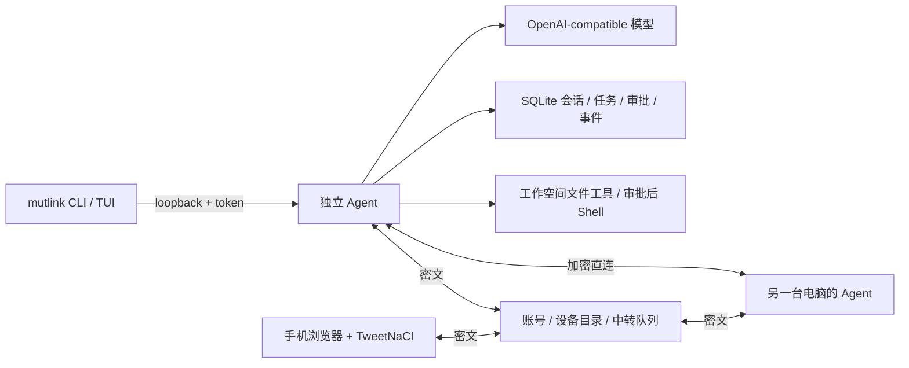

# mutlink

一个可独立工作的终端 Agent，同时支持跨设备协作。默认执行 `mutlink` 打开参考 OpenCode 交互组织的 TUI；不登录也能使用本地模型和工作空间。手机浏览器可通过自托管中转服务控制已配对的电脑。

当前是可运行的 **0.1 原型实现**，不是完整生产发行。模型调用、工具执行、数据库、加密与通信均为真实实现；测试中使用本地模拟模型服务，不消耗云端额度。

## 开始使用

从 [GitHub Releases](https://github.com/cdcRyan/mutlink/releases) 下载对应系统的压缩包，解压后可直接执行 `./mutlink`（Windows 为 `mutlink.exe`），或用随包的 `sh scripts/install.sh` 安装到用户目录。无需 Rust、Node 或 Python。支持 macOS Apple Silicon / Intel、Linux ARM64 / x64（glibc 2.35+）和 Windows x64。

仓库当前为私有：只有获得仓库访问权限的 GitHub 用户可以下载。安装 [GitHub CLI](https://cli.github.com/) 并登录后，macOS / Linux 可以执行：

```sh
gh auth login
gh release download --repo cdcRyan/mutlink --pattern install.sh --dir /tmp/mutlink-install --clobber
MUTLINK_USE_GH=1 sh /tmp/mutlink-install/install.sh
# 默认安装至 ~/.local/bin；如未加入 PATH：
export PATH="$HOME/.local/bin:$PATH"
mutlink --version
```

Windows PowerShell：

```powershell
gh auth login
gh release download --repo cdcRyan/mutlink --pattern install.ps1 --dir "$env:TEMP\mutlink-install" --clobber
$env:MUTLINK_USE_GH = "1"
& "$env:TEMP\mutlink-install\install.ps1"
$env:Path = "$env:LOCALAPPDATA\mutlink\bin;$env:Path"
mutlink --version
```

安装脚本自动识别平台、下载并校验 SHA256。可通过 `MUTLINK_VERSION=v0.1.0` 固定版本、`MUTLINK_INSTALL_DIR` 指定目录。升级前执行 `mutlink stop`，重跑安装命令即可；旧程序保留为 `.previous`，不会删除 Agent 数据。PATH 示例只对当前终端有效，可将对应目录加入用户持久 PATH。

匿名 `curl` 安装和 Homebrew 分发的启用方式，以及维护者的发版命令，见 [发布与安装渠道](docs/distribution.md)。当前没有代码签名、公证或自动更新服务。

### 从源码安装

源码构建需要 Rust 1.88+ 和系统 C 编译工具。运行编译后的单文件程序不需要 Rust、Node、Python 或额外数据库。Web 资源已嵌入二进制。

```sh
gh repo clone cdcRyan/mutlink
cd mutlink
cargo build --release --locked
sh scripts/install.sh
# 默认安装至 ~/.local/bin；将该目录加入 PATH
mutlink --help
```

Windows 使用 MSVC Rust 工具链和 Visual Studio C++ Build Tools，执行 `powershell -File scripts/install.ps1`。也可以用 `cargo install --path . --locked`。

未安装 Rust 时，请先从 [rustup.rs](https://rustup.rs/) 安装稳定版工具链。

### 独立运行

```sh
# 在你要授权给 Agent 的项目目录中执行。
# 必须先设置密钥，再启动 daemon；密钥不会写入 mutlink 配置。
export OPENAI_API_KEY='你的密钥'
mutlink model set --model gpt-4.1
mutlink workspace .
mutlink
```

第一次 CLI 调用会启动后台 Agent，TUI 关闭后仍继续运行。已有 daemon 不会自动获得后来新增的环境变量：更改密钥后执行 `mutlink stop`，再从设置好环境的终端启动 `mutlink`。

支持提供 **Chat Completions + SSE + tool calls** 的 OpenAI 兼容模型服务：

```sh
mutlink model set --model your-model \
  --base-url https://your-provider.example/v1 --api-key-env YOUR_API_KEY

# 本地兼容服务允许不配置密钥，端口与模型名按实际服务修改
mutlink model set --model your-local-model --base-url http://127.0.0.1:1234/v1
mutlink run "说明这个项目的入口和主要模块" --plan
mutlink run "检查 README，修正一个明确的拼写错误并说明变更"
```

没有配置可用模型时显示配置提示，不伪造 Agent 回答。不是所有标注“OpenAI 兼容”的服务都支持工具调用；供应商兼容性须实际验证。

### 终端交互

| 操作 | 用途 |
|---|---|
| Enter / Alt+Enter | 发送 / 换行 |
| Shift+Tab | Build 与只读 Plan 切换 |
| Ctrl+A | 查看待审批的完整工具参数；弹窗内 y 同意、n 拒绝 |
| Esc | 取消当前任务 |
| PageUp / PageDown | 滚动执行记录与审批内容 |
| Ctrl+C / `/quit` | 退出界面，保留后台 Agent |
| `/new`、`/sessions`、`/resume <session-id>` | 新会话、历史列表、恢复本地会话 |
| `/devices`、`/device <完整设备ID>`、`/device local` | 设备详情、选择远端或本地执行 |

文件读取、列表和搜索限制在已授权工作空间。写文件与 Shell 必须逐次确认；原文件写入前生成同目录备份。Shell 使用当前操作系统用户权限，**不属于 OS 沙箱**，即使工作目录限定，也可以访问该用户有权访问的其他资源。

一个设备 home 对应一个工作空间。多个项目需要独立 home，例如 `mutlink --home .mutlink workspace .`、`mutlink --home .mutlink`；该目录包含秘密，务必放入项目忽略规则。

## 跨电脑直连

两台电脑分别初始化并命名，保持 Agent 运行。以下假设电脑 A 是控制端，B 是执行端：

```sh
# B：开放只接收加密包的 peer 端口
mutlink stop
mutlink serve --peer-listen 0.0.0.0:7447

# B 的另一个终端：填写 A 能访问的地址，导出公开身份
mutlink device --name "Build Mac" --endpoint http://192.168.1.20:7447
mutlink pair export > b-public.json

# A：导出公开身份
mutlink pair export > a-public.json
```

通过可信渠道交换公开文件，另行核对双方完整 64 位指纹（JSON 的 `id` 字段）。不要只对比短前缀。

```sh
# A 信任 B，用于加密发送和验证返回结果
mutlink pair trust b-public.json --fingerprint <B的完整ID>

# B 信任 A，并允许 A 发起 Agent 任务
mutlink pair trust a-public.json --fingerprint <A的完整ID> --allow-agent

# A：交给 B 执行
mutlink run "检查项目目录并说明结构" --plan --device <B的完整ID>
```

直连使用已固定公钥的端到端密文，LAN HTTP 不承载明文任务或登录凭据。本地管理 API 始终单独绑定随机 loopback 端口，需要本机令牌，并拒绝浏览器 Origin。

## 中转与手机控制

启动自托管中转服务：

```sh
mutlink relay --listen 127.0.0.1:7448 \
  --database /path/to/private/relay.db --allow-registration
```

本机访问 `http://127.0.0.1:7448` 即可打开浏览器控制端。跨机器访问需在中转前配置 HTTPS，例如 Caddy：

```caddyfile
mutlink.example.com {
    reverse_proxy 127.0.0.1:7448
}
```

使用自己控制的域名与服务器。源码没有预设可用的公网中转地址。账号创建完成后，重新启动 relay 时去掉 `--allow-registration` 可关闭新用户注册。

```sh
# 第一台电脑注册账号；密码以无回显方式输入，至少 12 字节
mutlink login --relay https://mutlink.example.com --account me --register

# 第二台电脑登录同一个账号
mutlink login --relay https://mutlink.example.com --account me
mutlink devices
```

登录自动注册设备，1 秒轮询维持在线状态；超过 15 秒未更新显示离线。断网后退避重连（最长 30 秒）。已配对电脑优先使用导出的直连地址，不通再走中转。

手机步骤：

1. iOS Safari / Android Chrome 打开中转地址，登录同一个账号。
2. 在“设备配对”导出手机公开身份，把文件交给电脑；电脑运行 `pair trust ... --fingerprint ... --allow-agent`。
3. 电脑运行 `mutlink pair export`，在手机导入该 JSON，并输入通过另一渠道核对的完整指纹。
4. 选择电脑，输入任务，查看逐步执行结果。需要写文件或执行命令时，在电脑 TUI 按 Ctrl+A 确认。

浏览器身份密钥与已信任公钥保存在该站点的 localStorage，登录令牌保存在 sessionStorage。浏览器端密文协议与 Rust 一致，使用 vendored TweetNaCl 1.0.3，无第三方 CDN。清除站点数据会创建新身份，需重新配对。浏览器客户端依赖其加载来源可信，私钥尚未接入硬件密钥库。

手机当前是前台控制端：不在 iOS/Android 后台运行任意 Shell，不具备原生推送。手机休眠或关闭页面时，电脑可继续执行；重新打开后恢复任务事件。

## 任务恢复与授权

```sh
mutlink run "检查项目" --detach --id <你生成的UUID>
mutlink tasks
mutlink events <task-id>
mutlink events <task-id> --device <完整设备ID> --after 100
mutlink cancel <task-id> --device <完整设备ID>
mutlink approvals
mutlink approve <approval-id> --allow
mutlink approve <approval-id> --deny
mutlink pair revoke <完整设备ID>
mutlink logout
mutlink stop
```

远端只能查看或取消自己创建的任务，不能批准敏感工具，也不能读取其他设备创建的会话。撤销信任同时请求取消该来源的活跃任务，已执行的操作不回滚。

请求使用稳定 task ID 去重。连接超时不能证明任务未执行：先查询原 ID，或以**相同 ID、prompt、session 和 plan**重试。不同内容复用同一 ID 会被拒绝。同会话同时只运行一个任务。

SQLite 持久化会话、任务、事件与一次性审批。Daemon 异常重启后，未完成任务标记 `unknown`，不自动重放可能已产生副作用的操作；请先检查实际文件/命令结果。中转密文包有效期 120 秒，不提供无限期离线命令队列。敏感操作审批 5 分钟过期。

## 实现结构



| 模块 | 实现 |
|---|---|
| `agent.rs` / `provider.rs` | 流式模型、工具循环、只读模式、步数/时间限制、取消、panic 转任务失败 |
| `tools.rs` | cap-std 工作空间访问、写入备份、审批后的 Shell、输出/时长限制 |
| `tui.rs` / `client.rs` / `main.rs` | Ratatui 终端界面、daemon 自动启动、CLI |
| `server.rs` | 本地管理 RPC 与独立加密 peer 入口 |
| `crypto.rs` / `network.rs` | X25519 + XSalsa20-Poly1305、指纹固定、重放检查、直连/中转 |
| `relay.rs` | Argon2id 密码、7 天设备令牌、账号隔离、能力目录、在线状态、密文队列 |
| `web/` | 手机/桌面浏览器控制端，原生 JS，无构建步骤 |
| `store.rs` | SQLite WAL、幂等提交、一次性审批、事件游标、重启恢复 |

## 验证与当前边界

```sh
cargo fmt --check
cargo clippy --all-targets -- -D warnings
cargo test --locked
cargo build --release --locked
python3 -m pip install playwright
python3 -m playwright install chromium
python3 tests/browser_smoke.py
python3 tests/tui_smoke.py  # macOS / Linux，真实 PTY 启动
```

测试覆盖模型 SSE 工具循环、真实文件审批、Plan/拒绝审批、越界路径和符号链接、重放与篡改、双 Agent 直连、中转账号隔离、本地 API 认证、浏览器/Rust 加密互通、刷新恢复及手机/桌面布局。浏览器截图在 `.artifacts/`。所有自动化模型测试都使用本地 HTTP fixture；未用用户真实 API key 做云模型调用。

Release 工作流在五种原生目标上执行 Rust 测试、构建和安装冒烟测试，全部通过后才发布。macOS 15、Ubuntu 22.04 和 Windows Server 2022 为构建环境；不代表所有旧系统版本或真实 iOS/Android 设备均经过验证。

尚未实现的生产能力：

- OIDC / Passkey / MFA、账号恢复和管理后台。
- OS 沙箱/容器执行、原生移动 Agent 与系统推送。
- WebRTC/ICE/TURN 自动打洞、Noise 前向保密握手、公钥轮换协议。
- 操作系统密钥库、浏览器硬件密钥绑定、第三方安全审计。
- 开机服务安装、自动升级、签名/公证、公共包管理器收录。
- 大规模中转集群、多租户配额、长期离线队列、跨设备共享文件同步。
- 上下文自动压缩、provider 专用协议、浏览器自动化工具与插件生态。

目前采用静态设备公钥的 NaCl box，**没有前向保密**。中转可见账号、设备元数据、流量时序，不可读取配对设备间的任务密文；终端发送给所选模型提供商的提示和工具结果仍由该提供商处理。日志与会话数据库在本机存明文。认证含每账号窗口限流与哈希并发限制，公网部署仍需反向代理限流、TLS、备份和实际容量验证。

## 参考与许可

TUI 布局与交互参考 [OpenCode](https://github.com/anomalyco/opencode)，调研固定提交 `7945de208964a49300d7f770d1a71d078db9a4c4`。mutlink 的 Agent、界面与协议为本项目独立实现，未嵌入 OpenCode 源码。

项目使用 MIT；浏览器加密依赖 TweetNaCl 的许可随 `web/vendor/TWEETNACL-LICENSE` 分发。其他 Rust 依赖见 `Cargo.lock`。
