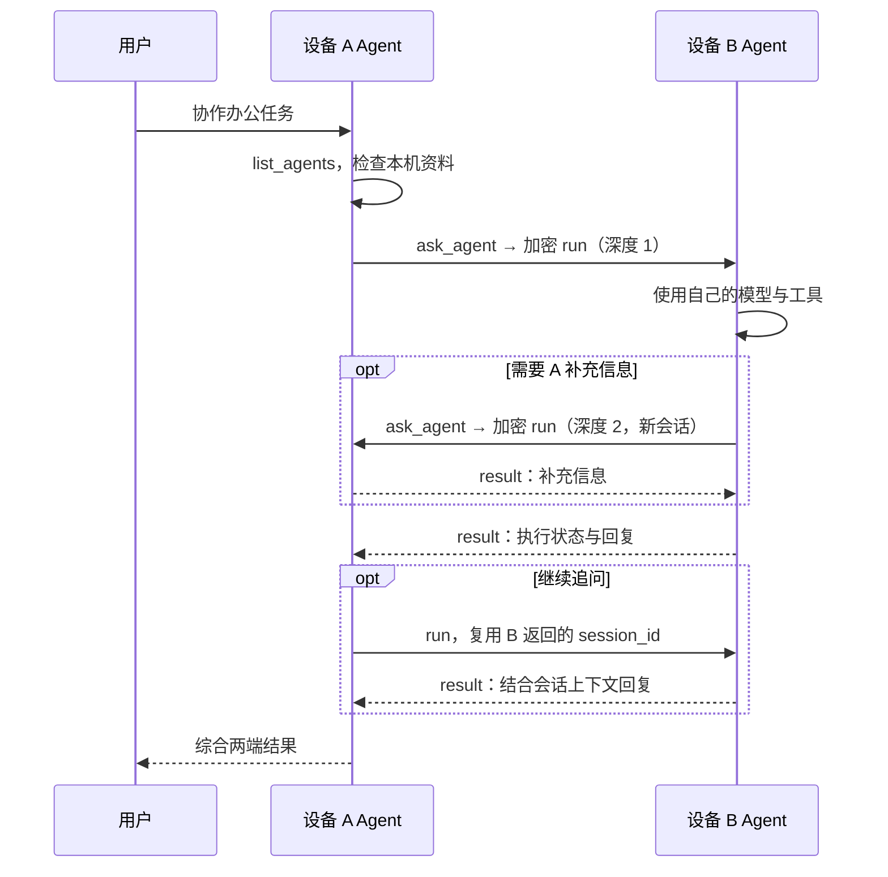

# 局域网双 Agent 协作

## 工作方式

设备 A 和 B 各自运行独立的 mutlink daemon、模型连接、SQLite 数据库和工作空间。两端交换公开身份并双向授权后，任意一端可发起任务。无需账号或中心服务器。



这是一套 mutlink 自有协议，当前不声明兼容 MCP 或标准 A2A。默认沿用已有的 HTTP + NaCl box；可在现有加密传输上继续演进。

## 传输与身份

- 局域网入口：`POST http://<设备局域网IP>:7447/peer`，JSON。
- 外层包：`id`、`from`、`to`、`nonce`、`ciphertext`。其中 nonce 和密文用 Base64 编码。
- `from` / `to` 为公钥 SHA-256 完整指纹，设备间事先固定公钥。
- X25519 + XSalsa20-Poly1305 加密；密文中再次绑定包 ID、发送方、接收方。
- 解密后的内容版本为 `1`，包含 `issued_at`、`expires_at`、`payload`。包有效期最长 120 秒，重复包被拒绝；需保持设备时钟基本同步。
- 本地管理接口使用独立的 loopback 端口和本地令牌。peer 端口不暴露模型配置、配对管理或审批操作。
- 配有中转时仍沿用直连优先、中转回退；纯局域网配置无需启动中转。

## 请求与回复

加密载荷中的请求形式：

```json
{
  "kind": "request",
  "body": {
    "id": "<本次 RPC ID>",
    "action": "run",
    "payload": {
      "id": "<稳定任务 ID>",
      "session_id": null,
      "prompt": "检查你的项目结构并回复模块分工",
      "plan": true,
      "delegation_depth": 1
    },
    "expires_at": 1790700090
  }
}
```

示例时间戳仅展示字段格式，实际请求动态设置过期时间。RPC ID 对应一次请求/回复，任务 ID 用于执行去重，两者含义不同。

| action | 用途 | 授权 |
|---|---|---|
| `status` | 查询设备和能力；自主委派前确认 `agent.collaborate` 可用 | 已配对 |
| `run` | 提交任务，立即返回任务对象 | 接收端对发送方设置 `allow_agent` |
| `task` | 查询任务状态 | 只能查询该发送设备创建的任务 |
| `result` | 返回 `{task, answer: {text, truncated}}` | 同上 |
| `events` | 按游标查询所属会话事件 | 同上 |
| `cancel` | 请求取消任务 | 同上 |

回复载荷为 `{"kind":"response","body":{"id":"<RPC ID>","ok":true,"data":{...}}}`。失败时 `ok` 为 `false`，`data.error` 包含原因。

`result` 的回答取自该任务最后一条 assistant 事件，最多 32768 个 Unicode 字符，超长通过 `truncated` 标记。只有 `task.state` 进入终态后，协作工具才将结果交回调用方模型。`failed`、`cancelled`、`unknown` 都不代表成功，调用方需结合状态和错误处理。

## 协作约束

`ask_agent` 接收 `device_id`、`prompt` 和可选的 `session_id`、`plan`。委派深度由运行时设置，模型不能指定：

- 普通本地或 CLI 远端任务深度为 0，A 委派 B 为 1，B 回问 A 为 2。
- 深度 2 不提供 `ask_agent`；即使模型强行调用也会被拒绝。接收端拒绝超过 2 的深度。
- 这是对正常 mutlink Agent 委派链的执行限制，不是针对已获授权恶意客户端的全局配额。
- 子任务强制继承父任务的只读约束；Build 父任务也可主动要求只读子任务。
- `session_id` 不传时创建独立会话，避免回问占用正在等待的父会话。传入时只允许恢复同一发送设备的远端会话，且会话不能有正在运行的任务。
- 双方完整记录各自任务；只共享明确传递的提示和回复，不共享数据库、凭据或整个文件系统。
- 执行端审批仍适用于写文件与 Shell，远端不能代批。

普通请求省略 `delegation_depth` 时按 0 处理，序列化时也省略 0，以兼容旧数据库中的幂等请求。自主委派前查询运行时能力，避免旧版本忽略深度字段而形成无限委派。

## 失败与恢复

子任务 ID 由发起设备 ID、父任务 ID 和模型工具调用 ID 稳定生成，同一工具调用重复提交沿用同一任务 ID；服务端同时校验提示、会话、模式和深度，内容不同则拒绝。模型重新产生的工具调用不自动视为同一任务。

父任务记录 `delegation_start`、`delegation_accepted`、`delegation_result`，包含远端设备、任务/会话标识和耗时。即使收到执行回复前断连，已记录的子任务 ID 仍可用于核对：

```sh
mutlink events <父任务ID>
mutlink events <子任务ID> --device <执行设备完整ID>
mutlink cancel <子任务ID> --device <执行设备完整ID>
```

每次委派最多等待 10 分钟，等待中轮询终态。取消、超时或发送后的网络错误触发一次尽力取消（最多等待 3 秒）。取消回复只表示已请求取消，不能证明所有操作都已停止或回滚。断连时报告 `unknown` 和 `reconcile_before_retry`，保留任务 ID，避免把“未收到回复”当成“未执行”。发送前的能力或连接检查失败报告 `rejected`。

父进程崩溃时无法保证发送取消；恢复后父任务按已有规则标记为 `unknown`，远端可能仍在执行，需按委派事件核对。协议不自动重放已产生副作用的任务，也不提供永久离线队列。

## 验证范围

`tests/collaboration.rs` 使用两个独立 home、工作空间、模型 fixture 和真实 loopback HTTP peer 端口，验证双向委派、回问、同会话追问、只读继承、深度限制、远端结果归属、执行端审批及父任务取消传播。模型 fixture 不调用云端模型。

自动化测试不等同于两台物理设备的实测。实际局域网部署还取决于可路由的 IP、TCP 端口可达、双方运行中的服务，以及各自配置的模型支持工具调用。
